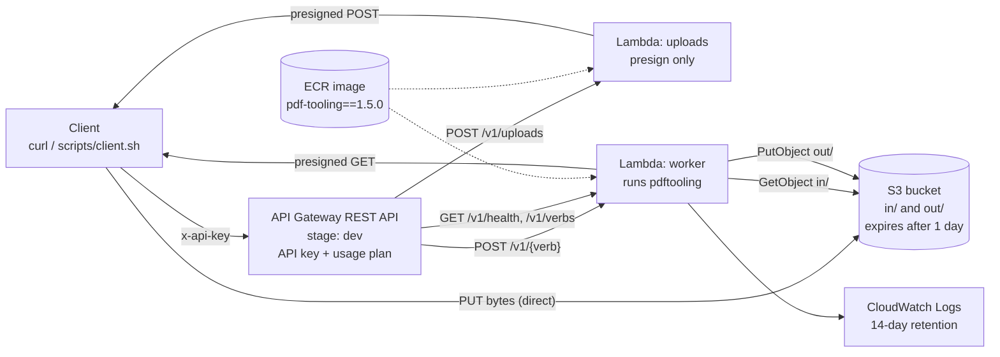

# 01 — Stack design

## Goals and non-goals

**Goals**
- Expose pdf-tooling 1.5.0's core verbs over HTTPS with no change to their semantics.
- Cost about $0 when idle and stay cheap and capped under use, since the endpoint is public.
- Deploy from scratch with one command, and tear down with one.

**Non-goals for the PoC**
- OCR and Office conversion (`ocr`, `convert`), multi-tenant billing, a web UI, custom domains, multi-region.

## Architecture



## Component decisions

| Concern | Decision | Why |
|---|---|---|
| Orchestration | **Serverless Framework v4** (`serverless.yml`) | Requested. v4 requires `serverless login` or a `SERVERLESS_ACCESS_KEY`, and is free for individuals and organisations under $2M in annual revenue. If the login requirement gets in the way, the open-source v3 fork `osls` reads the same `serverless.yml` for everything this design uses. |
| API front door | **API Gateway REST API** (`http` events), not HTTP API | API keys and usage plans (throttle + daily quota) exist only on REST APIs. Without them, a public PoC endpoint can be spent by anyone. |
| Compute | **AWS Lambda, container image, `arm64`** | pdf-tooling depends on native wheels (pikepdf/libqpdf, pypdfium2, Pillow, cryptography). An image pins the exact environment, can be run locally with the Lambda Runtime Interface Emulator, and leaves room to add Tesseract later. arm64 (Graviton) costs about 20% less per GB-second. |
| Base image | `public.ecr.aws/lambda/python:3.13` | pdf-tooling supports Python 3.11–3.14. 3.13 is the newest Lambda base image this design is sure exists; move to 3.14 once AWS publishes it. |
| Packaging | `pip install pdf-tooling==1.5.0` with `--require-hashes` from a pinned `requirements.txt` | Reproducible builds; the version endpoint reports exactly what is deployed. |
| How the handler calls pdf-tooling | **`subprocess` of the `pdftooling` CLI** with `-o json`, never an import of `pdf_tooling.ops` | The JSON envelope and the exit-code table are pdf-tooling's *public* API; `ops/` is internal and can change in any release. Calling the CLI makes the API inherit pdf-tooling's own guarantees (dry-run purity, atomic writes, password handling). Process startup is the cost, and Phase 1 measures it. |
| File transfer | **S3 presigned POST in, presigned GET out**; PDF bytes never pass through API Gateway | API Gateway caps a request at 10 MB and Lambda caps a synchronous response at 6 MB. Presigned POST also lets S3 enforce the size limit (`content-length-range`) before the Lambda sees the file. |
| Storage | One S3 bucket with `in/{api_key_id}/{upload_id}` and `out/{api_key_id}/{request_id}/…` | Every key is namespaced by the caller's API key id (`requestContext.identity.apiKeyId`) and generated by the server. A client never names an S3 key, so it cannot read another caller's files. |
| Execution model | **Synchronous** for the PoC; Lambda timeout 28 s | API Gateway's default integration limit is 29 s. Jobs that take longer get the async design in Phase 7. |
| Scratch space | `/tmp/req-{request_id}/`, deleted in `finally`; `ephemeralStorage: 2048` MB | Lambda reuses `/tmp` across warm invocations. Deleting the whole request directory also removes any `.pdftoolkit-*` temp files a hard kill would leave behind. |
| Memory | 2048 MB (worker), 256 MB (uploads) | CPU scales with memory; tune in Phase 6 from measurements. |
| Functions | Two functions from **one image**, each with its own `command` | `uploads` only presigns and needs no PDF engine, but sharing the image keeps the PoC to one build. Splitting it into a zip function is an optimisation, not a requirement. |

## Serverless Framework layout (planned)

```yaml
service: serverless-pdf-api
frameworkVersion: "4"

provider:
  name: aws
  region: ${opt:region, 'us-east-1'}
  stage: ${opt:stage, 'dev'}
  architecture: arm64
  logRetentionInDays: 14
  ecr:
    images:
      app:
        path: ./
        platform: linux/arm64
  environment:
    BUCKET: ${self:custom.bucket}
    PDFTOOLING_VERSION: "1.5.0"
    HOME: /tmp                     # Lambda's filesystem is read-only outside /tmp
    MAX_UPLOAD_BYTES: "52428800"   # 50 MB
  apiGateway:
    apiKeys:
      - ${self:service}-${sls:stage}-demo
    usagePlan:
      quota: { limit: 1000, period: DAY }
      throttle: { rateLimit: 5, burstLimit: 10 }
  iam:
    role:
      statements:
        - Effect: Allow
          Action: [s3:GetObject, s3:PutObject]
          Resource: arn:aws:s3:::${self:custom.bucket}/*

functions:
  uploads:
    image: { name: app, command: ["api.handlers.uploads.handler"] }
    memorySize: 256
    timeout: 10
    events:
      - http: { path: v1/uploads, method: post, private: true }
  worker:
    image: { name: app, command: ["api.handlers.worker.handler"] }
    memorySize: 2048
    timeout: 28
    ephemeralStorageSize: 2048
    reservedConcurrency: 5          # a hard ceiling on parallel spend
    events:
      - http: { path: "v1/{verb}", method: post, private: true }
      - http: { path: "v1/meta/{sub}", method: post, private: true }
      - http: { path: v1/health, method: get, private: true }
      - http: { path: v1/verbs, method: get, private: true }

resources:
  Resources:
    Bucket:            # block all public access, SSE-S3, 1-day expiry on in/ and out/
    # plus: an AWS Budgets alarm at $5/month to the operator's e-mail (Phase 0)
```

Phase 5 checks the exact keys against the Serverless v4 docs. In particular, the `ecr.images.*.platform` spelling and whether the usage-plan quota is set per stage need confirming.

## Security posture

| Threat | Control |
|---|---|
| Anyone runs up the bill | API key required on every route; usage plan of 5 rps, burst 10, 1000 requests/day; `reservedConcurrency: 5`; budget alarm. |
| Argument injection into the CLI | `subprocess.run([...])` with an argument list and no shell. Option names come from a per-verb allowlist, and values are passed as `--flag=value` so a value starting with `-` can never be read as a flag. Server-controlled flags (`-O`, `--out-dir`, `--name`, `--in-place`, `--no-backup`, `-f`, `-y`, `--password-file`, `--threads`, `-o`) are never accepted from the client. |
| Path traversal and cross-tenant reads | Files on disk are named by the server (`input-1.pdf`…), never from a client filename. Inputs are upload ids resolved under the caller's own `in/{api_key_id}/` prefix. |
| Password leakage | Passwords arrive in the JSON body over TLS. They are written to `0600` files inside the request directory and passed with `--password-file`, so they never reach `argv`, which matches pdf-tooling's own rule. Request bodies are never logged, and API Gateway data tracing is off. |
| Oversized or hostile PDFs | S3 enforces the 50 MB upload cap. pdf-tooling's render budget and engines apply. The subprocess runs with a deadline that stops it 2 s before the Lambda timeout, so the handler can still return a clean `504`. |
| Leftover data | S3 lifecycle deletes `in/` and `out/` after 1 day. Presigned URLs live 15 minutes. `/tmp` is wiped after every request. |
| Secrets in a public repo | No account id, API key or ARN is committed. The API key value is read with `serverless info --verbose` or `aws apigateway get-api-key --include-value` and kept in a local `.env`, which is git-ignored. |

## Cost model (rough, us-east-1, arm64)

| Item | Estimate |
|---|---|
| Idle | about $0.03/month (ECR storage for a roughly 300 MB image) plus pennies of S3 |
| One worker request | 2 GB × 3 s ≈ 6 GB-s ≈ **$0.0001** compute, plus API Gateway at $3.50 per million requests |
| Worst case under the usage plan | 1000 requests/day × 30 days ≈ **$3–4/month** |

The daily quota is what makes the worst case bounded.
